<p align="center">
  
</p>

# DowFlow

Extensión para navegadores Chromium conectada a un host local en Python mediante Native Messaging. Permite descargar video o audio, elegir formatos y calidad, consultar listas de reproducción y gestionar descargas. El procesamiento se realiza en el PC con yt-dlp, FFmpeg y motores opcionales.

[Ver las ventanas y la Caja de Herramientas con capturas](#guía-visual-de-dowflow)

## Calidad y detección

- **Calidad fija:** guarda una resolución máxima para todas las descargas. Elige el mejor formato hasta ese límite; conserva fuentes menores y reduce con FFmpeg si solo existe una fuente mayor.
- **Detector:** muestra los formatos reales de cada video. La selección se respeta al descargar; permite reintentar una consulta fallida. En enlaces manuales o lotes, pide elegir formato antes de encolar.
- **Buscar streams:** busca enlaces HLS/DASH ya expuestos en la página y recursos cargados, sin recargarla.
- **Buscar en página:** revisa etiquetas de video, enlaces, HTML y recursos cargados, incluidos marcos accesibles.
- **Rastreador:** captura enlaces multimedia mientras la página carga o reproduce. El interruptor detiene el rastreo y limpia sus tarjetas.
- **Automatización de motor:** considera el enlace y las opciones solicitadas; la consola explica qué motor se utiliza y las alternativas por herramientas ausentes.

Más detalles y límites en [Calidad y detección](docs/CALIDAD_Y_DETECCION.md).

## Pistas de audio e idiomas

En **Audio e idiomas**, Español selecciona una pista española ofrecida por el origen; si no existe, elige la original identificada. Original prioriza la pista marcada como original. Si el sitio no identifica esa pista, se utiliza su preferencia predeterminada y se informa en la consola. Del sitio mantiene la elección habitual del origen.

Funciona con los sitios compatibles que exponen sus pistas mediante yt-dlp, no solo con YouTube. No genera traducciones ni doblajes. La consola muestra el idioma y la pista elegida. Más detalles en [Idiomas de audio](docs/IDIOMAS_AUDIO.md).

## Instalación en Windows

Los tres BAT de uso manual están en la raíz. Orden de instalación:

1. Ejecutar `instalar_requisitos.bat`. Comprueba Python y la disponibilidad de Tkinter para elegir carpetas.
2. Ejecutar `actualizar_e_instalar_motores.bat`. Instala o actualiza yt-dlp, FFmpeg, N_m3u8DL-RE y AtomicParsley dentro de `host/bin/`. Requiere conexión a Internet. aria2 es opcional y este script no lo instala; para usarlo, colocar `aria2c.exe` en `host/bin/`.
3. Abrir `chrome://extensions`, `edge://extensions` o `brave://extensions`, activar el modo desarrollador y cargar la carpeta `extension` como extensión descomprimida.
4. Ejecutar `conectar_extension.bat` e introducir el ID de la extensión. Genera el manifiesto local y registra el host para el usuario actual en Chrome, Edge y Brave. No requiere permisos de administrador porque utiliza HKCU.
5. Abrir una página con contenido multimedia, abrir la extensión, elegir la configuración y descargar.

Si se mueve la carpeta del proyecto o cambia el ID de la extensión, volver a ejecutar `conectar_extension.bat`.

## Guía visual de DowFlow

Las capturas muestran DowFlow 1.3.0 en Chromium. Los videos, el historial y las tareas que aparecen en ellas son ejemplos.

[Ventana de la extensión](#ventana-de-la-extensión) · [Caja de Herramientas](#caja-de-herramientas) · [Selección de calidad](#selección-de-calidad)

### Ventana de la extensión

En la barra superior del navegador, abre **Extensiones** y pulsa **DowFlow**. Puedes fijar su icono para abrirlo con un clic.

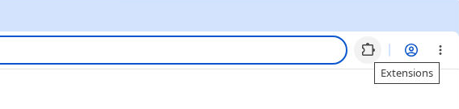

#### Detector

Abre la página del video y reprodúcelo. En **Detector**, elige la tarjeta que corresponde al video y pulsa **Descargar**. Si no aparece, prueba **Buscar en página** o **Buscar streams** cuando se trate de una transmisión HLS o DASH.

Para pegar tus propios enlaces, activa **Modo Personalizado (Enlace Manual)** en Configuración. Aparecerá el cuadro **Enlace Especial**.

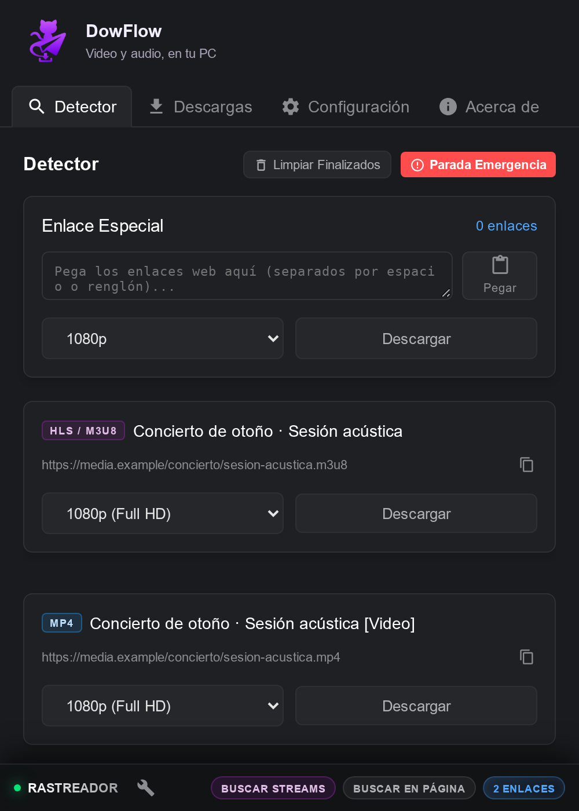

#### Descargas

Abre **Descargas** para consultar los archivos terminados. **Ver Origen** vuelve a la página del video y **Abrir Ubicación** abre su carpeta en Windows.

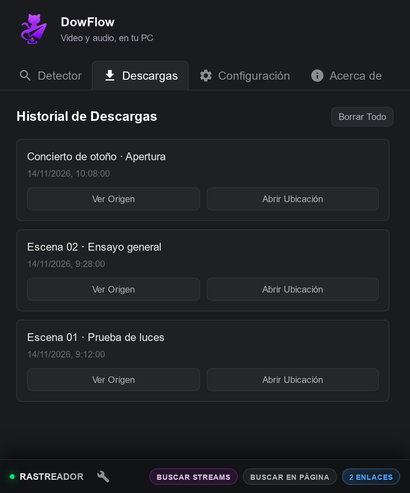

#### Configuración

Elige **Video** o **Audio** antes de descargar. Para mantener un límite de resolución, selecciona **Calidad fija** y escoge la altura máxima. Más abajo, **Seleccionar Carpeta...** cambia el destino de los archivos.

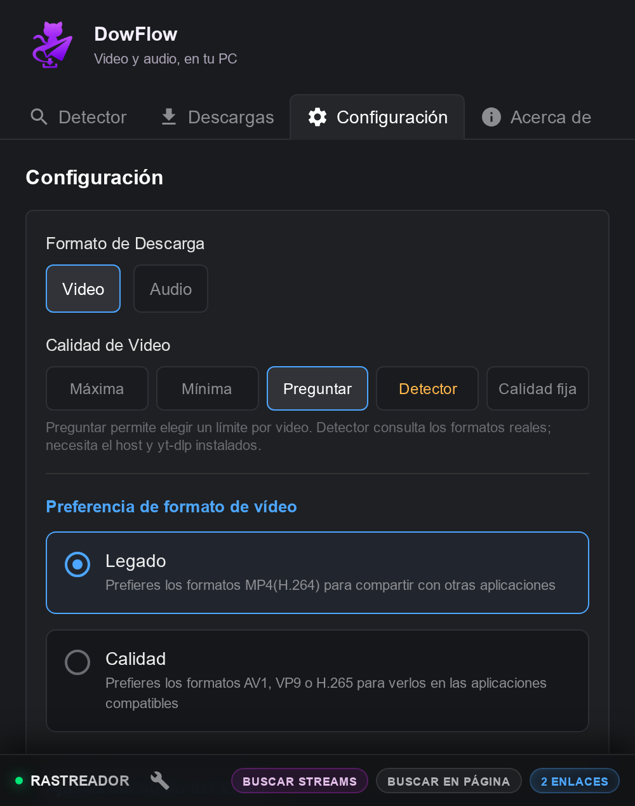

<details>
<summary>Ver motores y descargas simultáneas</summary>

Activa **Automatización de motor** para que DowFlow elija el motor según el enlace y el formato. Ajusta **Descargas simultáneas máximas** para limitar cuántos archivos se procesan a la vez.

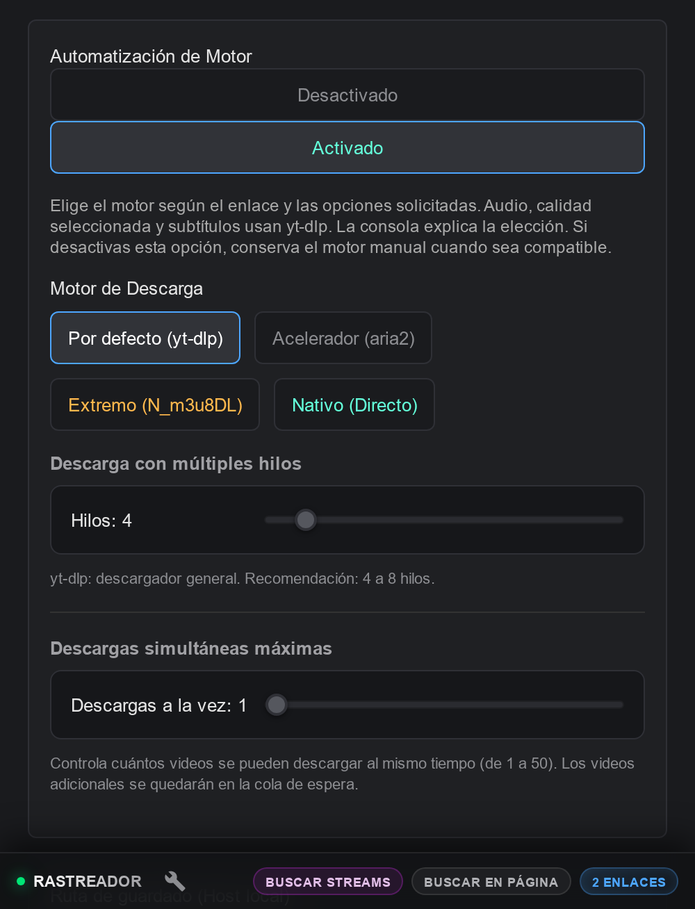

</details>

<details>
<summary>Ver el selector de carpeta</summary>

En **Seleccionar Carpeta...**, elige el destino y confirma. Con **Cancelar** conservas la carpeta anterior. La imagen muestra el selector del programa en Linux. En Windows se abre el selector de carpetas del sistema.

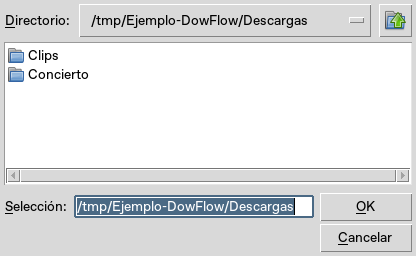

</details>

#### Acerca de

Consulta la versión instalada. Si una descarga falla, ve a **Consola de Procesos**, pulsa **Ir al final** y lee el último mensaje. **Copiar** copia el registro.

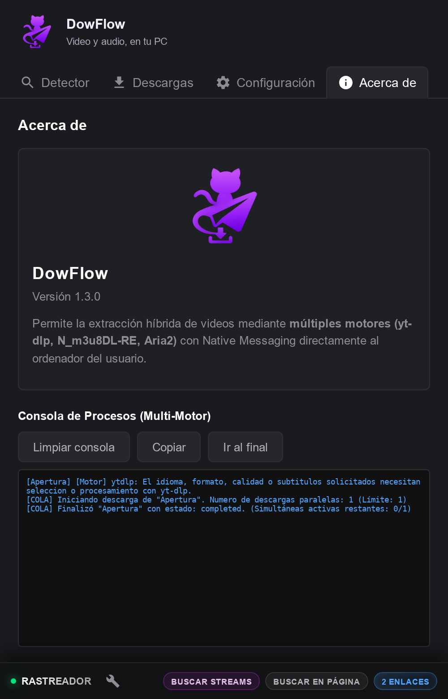

### Caja de Herramientas

Con DowFlow abierto, pulsa la **llave inglesa junto a Rastreador**, en el pie de la ventana. Al pasar el cursor aparece **Abrir Caja de Herramientas**. Se abre una pestaña nueva del navegador.

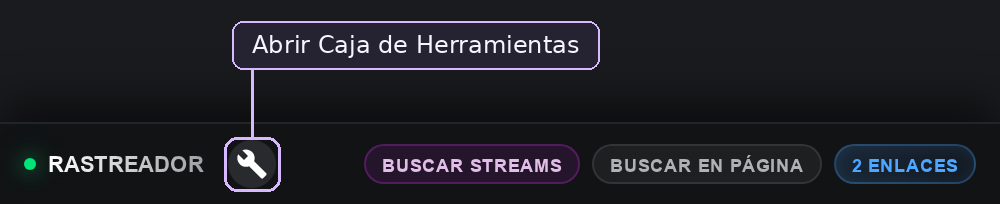

#### Dashboard

Pulsa una de las seis tarjetas para entrar en su herramienta. Puedes cambiar de sección con el menú lateral o volver aquí con **Dashboard**. En ventanas estrechas, abre el menú desde la esquina superior izquierda.

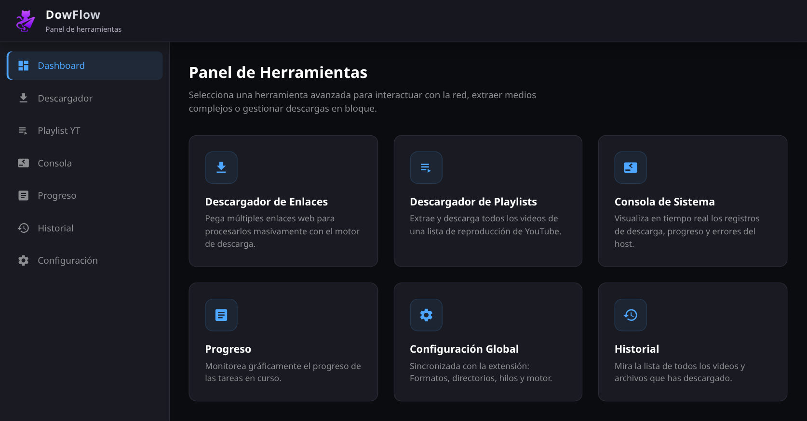

#### Descargador de Enlaces

Pega **una URL por línea** y elige cómo nombrar los archivos. Pulsa **Iniciar Descarga**. DowFlow abre la consola y te permite seguir cada tarea desde **Progreso**.

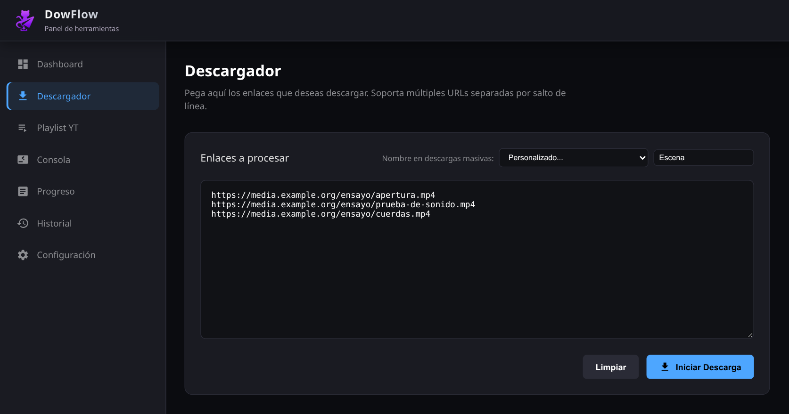

#### Playlist YT

Pega la URL de una lista de YouTube y pulsa **Analizar**. Deja marcados los videos que quieres guardar y pulsa **Descargar Seleccionados**. Si aparece «No hay videos seleccionados», cierra el aviso y marca al menos una casilla.

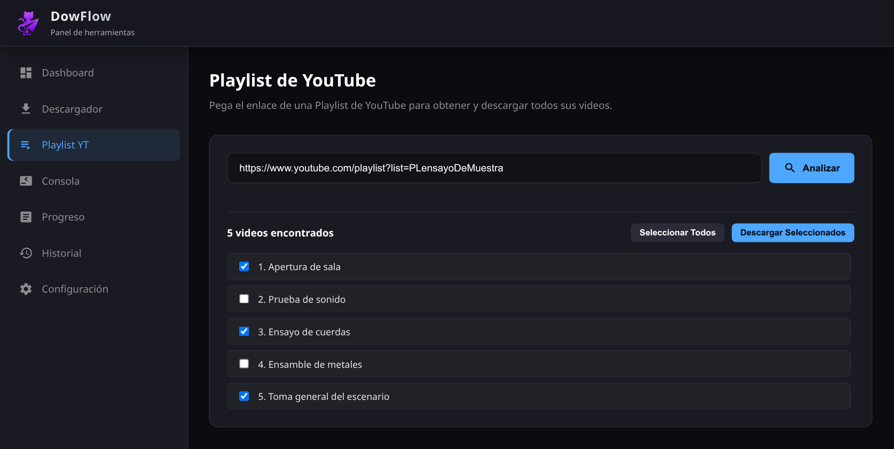

#### Consola

Lee los mensajes para saber qué motor se utilizó y en qué paso ocurrió un error. Si hay fallos, usa **Copiar todas las URLs** en **Enlaces que fallaron** para volver a procesarlas desde **Descargador**.

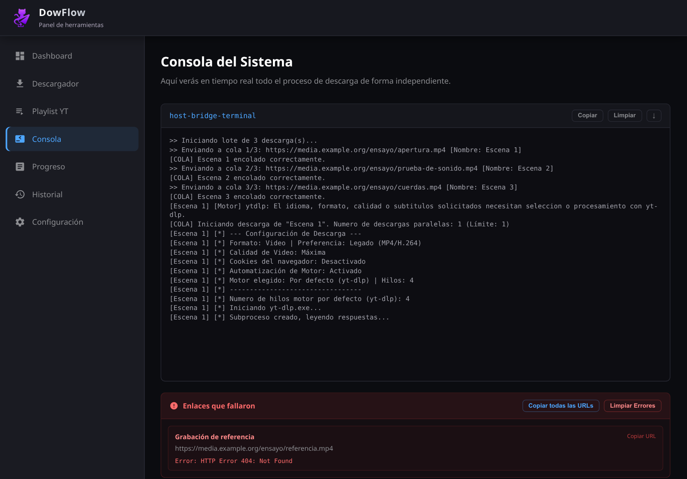

#### Progreso

Cada tarjeta muestra una tarea en curso o en espera. **Cancelar** detiene esa tarea. **Parada de Emergencia** pide confirmación antes de detener todas las descargas y vaciar la cola. Pulsa **Cancelar** en ese aviso si quieres que el lote continúe.

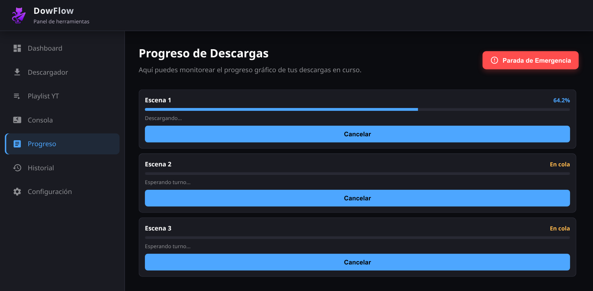

#### Historial

Busca el video por su título y fecha. **Abrir Ubicación** te lleva al archivo descargado y **Ver Origen** abre su página web.

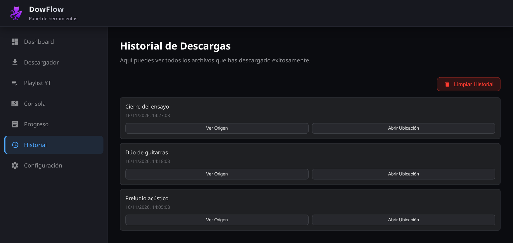

#### Configuración global

Cambia el formato, la calidad o la carpeta de destino desde esta pantalla. El popup y la Caja de Herramientas comparten estos ajustes en el mismo perfil del navegador.

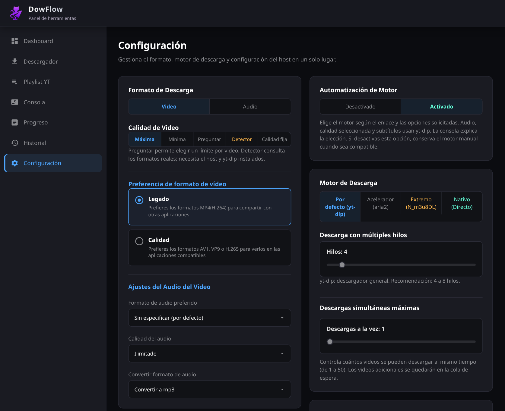

<details>
<summary>Ver carpeta, idioma y subtítulos</summary>

Elige dónde guardar los archivos y qué pista de audio prefieres. Si el video ofrece subtítulos, puedes elegir **Incrustar (ES/EN)** para activarlos o desactivarlos después desde tu reproductor.

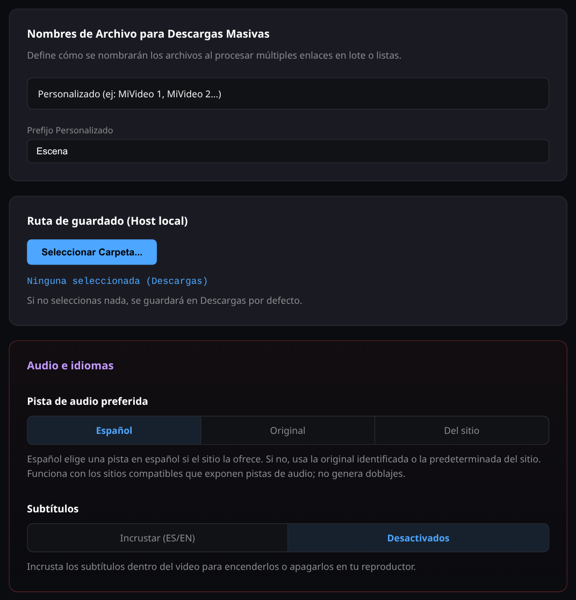

</details>

<details>
<summary>Ver enlace manual y rastreador</summary>

Activa **Modo Personalizado (Enlace Manual)** para mostrar **Enlace Especial** en el popup. El interruptor del rastreador controla si se añaden tarjetas al detectar contenido durante la reproducción.

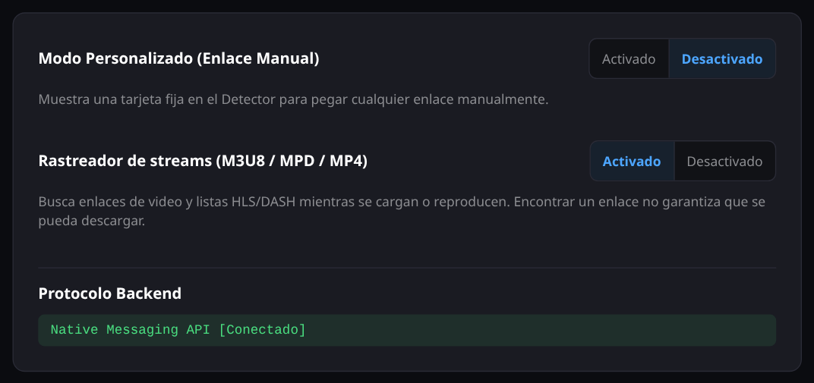

</details>

#### Selección de calidad

Si elegiste **Video → Detector** en Configuración y envías un enlace manual o un lote, se abre **Detector: elige la calidad**. Escoge un formato disponible y pulsa **Descargar**. **Reintentar** vuelve a consultar los formatos de ese enlace.

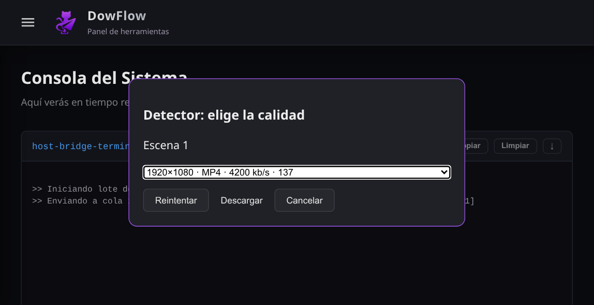

## Inicio automático

No hay una tarea de inicio con Windows. `conectar_extension.bat` registra el host una vez para el usuario actual. El navegador administra el proceso de fondo de la extensión y lanza Python cuando recibe una petición Native Messaging. No se deben ejecutar los BAT cada vez que se enciende el equipo.

`host/download_host.bat` es un lanzador interno llamado por el navegador; no es un cuarto paso de instalación manual.

## Estructura y mantenimiento

El [mapa del proyecto](docs/ESTRUCTURA.md) explica cada carpeta y archivo. El [registro de limpieza](docs/LIMPIEZA.md) documenta lo retirado, los cambios y las limitaciones pendientes.

- `extension/`: interfaz y coordinación desde el navegador.
- `host/`: descarga, conversión y comunicación con los programas locales.
- `tools/`: utilidades para desarrollar el proyecto.
- `docs/`: documentación de estructura y mantenimiento.

Los binarios, registros, cookies y la configuración generada para cada PC no se publican en Git. Los iconos se incluyen directamente en Git y en las descargas ZIP.

## Actualizar una instalación existente

Descargar los archivos nuevos o ejecutar `git pull` en la carpeta local. En la página de extensiones del navegador, pulsar **Recargar** y cerrar y abrir de nuevo el panel de herramientas. La extensión debe aparecer como **DowFlow**, versión **1.3.0**. Los cambios de GitHub no actualizan automáticamente una extensión cargada como descomprimida.

Si cambió la ubicación de la carpeta o el ID de la extensión, volver a ejecutar `conectar_extension.bat`. No hace falta reinstalar los motores si siguen disponibles en `host/bin/`.

La sincronización del popup y panel utiliza el mismo perfil e instalación de la extensión. Detalles en [Sincronización](docs/SINCRONIZACION.md).

## Verificación

Pruebas automáticas sin descargas ni conexión de red:

```sh
python -m unittest discover -s host/tests -p "test_*.py" -v
node --check extension/js/state.js
node --check extension/js/background.js
node --check extension/js/popup.js
node --check extension/js/tools.js
```

Para comprobar las dos interfaces y el gestor con APIs del navegador simuladas:

```sh
npm ci
npm test
```

Node y las dependencias de desarrollo solo son necesarios para estas pruebas; no para utilizar la extensión.

La prueba adicional de mezcla multilingüe real utiliza el paquete Python opcional `yt-dlp==2026.10.26` y FFmpeg/ffprobe en PATH. Sin ellos, esa prueba se omite. La aplicación sigue usando `host/bin/yt-dlp.exe`; no necesita instalar ese paquete Python.

Las pruebas manuales en `host/tests/manual/` requieren Windows, motores instalados y URLs elegidas por el usuario. Realizan descargas en la carpeta Downloads y no se ejecutan con la batería automática:

```sh
python host/tests/manual/test_download.py URL
python host/tests/manual/test_batch_downloads.py URL1 URL2
python host/tests/manual/test_postprocessor_resilience.py URL
```

La utilidad `tools/resize.py` necesita Pillow, solo para preparar iconos:

```sh
python -m pip install Pillow
python tools/resize.py imagen_original.png extension/icons/icon.png
```

## Alcance

La calidad y los formatos dependen de lo que ofrezca el origen y de los motores instalados. La compatibilidad con cada sitio puede cambiar. Los permisos de cookies y acceso a sitios se utilizan para detectar contenido y descargar con la sesión del navegador cuando el usuario lo selecciona.

Utilizar únicamente con contenido que se tenga derecho a descargar.
