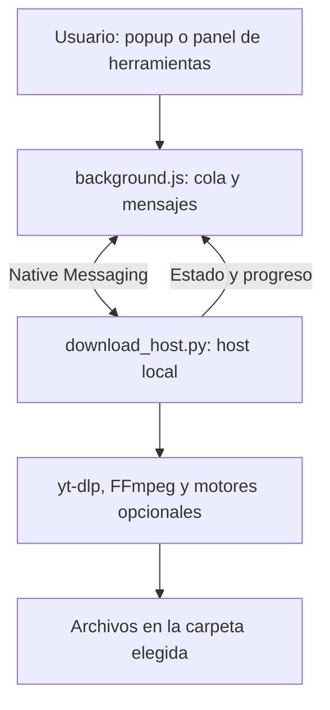

# Mapa del proyecto

## Cómo funciona

## Extensión: lo que se ve en el navegador

| Ruta | Función | ¿Se conserva? |
|---|---|---|
| `extension/manifest.json` | Define nombre, versión, permisos, iconos y proceso de fondo. | Sí, esencial. |
| `extension/popup.html` | Ventana que se abre al pulsar el icono de la extensión. | Sí. |
| `extension/css/popup.css` | Apariencia del popup. | Sí. |
| `extension/js/popup.js` | Opciones de descarga, detección, vista previa e historial del popup. | Sí. |
| `extension/js/background.js` | Coordina tareas, colas, cookies, detección de solicitudes y comunicación con Python. | Sí, esencial. |
| `extension/tools.html` | Panel amplio de herramientas y gestión. Incluye sus estilos. | Sí. |
| `extension/js/tools.js` | Lógica del panel, listas de reproducción, lotes, consola e historial. | Sí. |
| `extension/lib/hls.light.min.js` | Biblioteca externa usada para la vista previa HLS. | Sí, está referenciada en el popup. |
| `extension/icons/icon.png` | Logo rediseñado de 128 px para extensión, popup y panel. | Sí. |
| `extension/icons/icon-16.png`, `icon-32.png`, `icon-48.png` | Versiones dimensionadas para la barra, favicon y gestor de extensiones. | Sí. |
| `extension/icons/logo-512.png` | Versión de mayor tamaño, utilizada en Acerca de. | Sí. |

## Host: lo que trabaja en el PC

| Ruta | Función | ¿Se conserva? |
|---|---|---|
| `host/download_host.py` | Lee mensajes del navegador, prepara comandos, inicia descargas y comunica progreso y errores. | Sí, núcleo del backend. |
| `host/download_host.bat` | Lanza Python desde el navegador y conserva el canal de entrada/salida. | Sí. |
| `host/setup/install_ffmpeg.py` | Descarga FFmpeg y ffprobe para unir, convertir y analizar multimedia. | Sí. |
| `host/setup/install_nm3u8dlre.py` | Instala un motor especializado en streams. | Sí. |
| `host/setup/install_atomicparsley.py` | Instala una herramienta de metadatos. | Sí. |
| `host/tests/test_host.py` | Pruebas automáticas del cierre del host y cancelación de procesos. No descargan contenido. | Sí. |
| `host/tests/manual/test_download.py` | Ensayo manual de una descarga indicada mediante URL. | Sí, reorganizado. |
| `host/tests/manual/test_batch_downloads.py` | Ensayo manual con varias URLs suministradas al ejecutar. | Sí, reorganizado. |
| `host/tests/manual/test_postprocessor_resilience.py` | Ensayo manual de conservación del archivo tras posprocesar. | Sí, reorganizado. |

Estas rutas se crean en cada PC y no se deben subir al repositorio:

| Ruta generada | Para qué sirve |
|---|---|
| `host/bin/` | Ejecutables descargados: yt-dlp, FFmpeg, ffprobe y motores opcionales. |
| `host/bin/Logs/` | Registros de ejecución de los motores. |
| `host/com.gonzalo.videodownloader.json` | Ruta absoluta e ID local de la extensión, generados por `install_host.bat`. |
| `host/youtube_cookies.txt` | Archivo local de cookies, cuando corresponda. No compartir. |

## Instalación, utilidades y documentación

| Ruta | Función |
|---|---|
| `instalar_requisitos.bat` | Comprueba Python y Tkinter; intenta instalar Python si falta. |
| `install_host.bat` | Genera la configuración local y registra el host en Windows. |
| `scripts/actualizar_motores.bat` | Instala o actualiza motores en la carpeta `host/bin` de la raíz. |
| `scripts/apagado_emergencia.bat` | Detiene motores por nombre. Puede afectar otros programas; conservar como último recurso. |
| `tools/resize.py` | Prepara el icono PNG desde una imagen indicada en la consola; requiere Pillow. |
| `.gitignore` | Impide añadir binarios, registros, cookies, configuración local y temporales. |
| `.gitattributes` | Reglas de Git LFS para archivos grandes; los iconos pequeños se guardan directamente en Git. |
| `README.md` | Instrucciones de instalación, uso y pruebas. |
| `docs/ESTRUCTURA.md` | Este mapa. |
| `docs/LIMPIEZA.md` | Cambios realizados y tareas pendientes. |

## Dónde cambiar cada cosa

| Quiero cambiar… | Revisar primero |
|---|---|
| Colores o diseño del popup | `extension/css/popup.css` y `extension/popup.html` |
| Opciones y botones del popup | `extension/js/popup.js` |
| Panel y descargas por lotes | `extension/tools.html` y `extension/js/tools.js` |
| Colas, detección o conexión con Python | `extension/js/background.js` |
| Formatos, comandos de motores o descarga local | `host/download_host.py` |
| Instalación de dependencias | `scripts/actualizar_motores.bat` y `host/setup/` |
